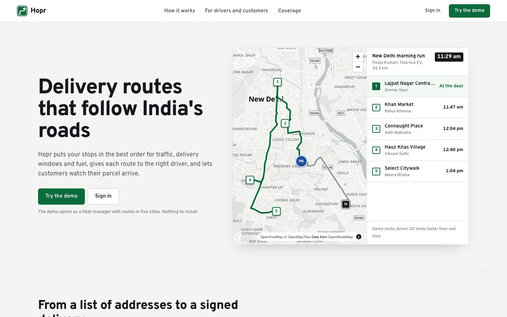
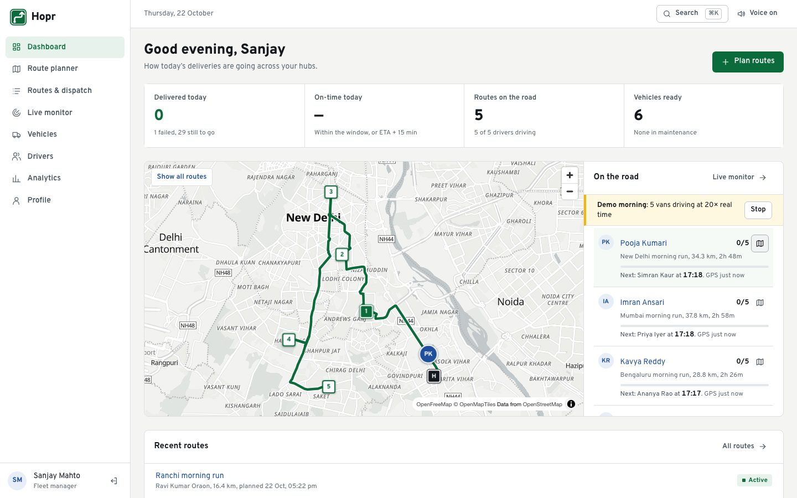
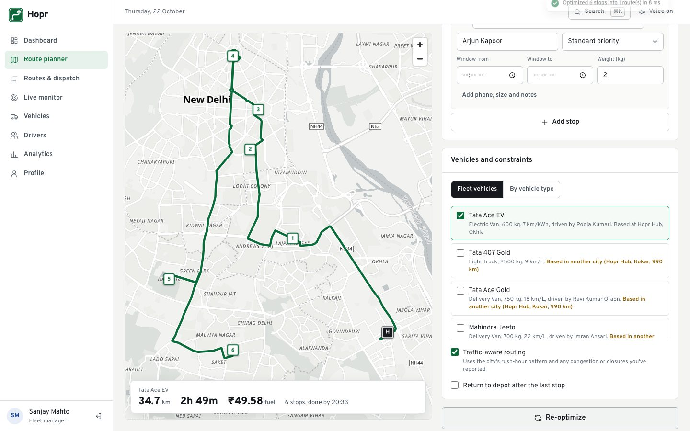
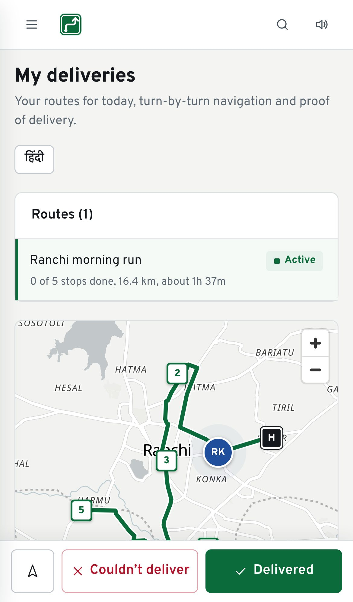
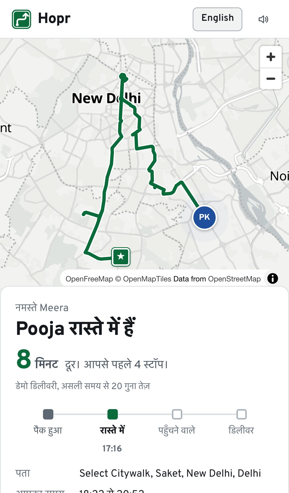

# Hopr

[](https://github.com/xreep/hopr/actions/workflows/ci.yml)

Route optimization for last-mile delivery anywhere in India. Fleet managers plan multi-stop, multi-vehicle routes that account for traffic, delivery windows, priority and fuel; dispatch them to drivers; and watch them live. Drivers deliver with photo and signature proof. Customers follow their parcel on a live tracking link.

- **Live app**: [hopr-one.vercel.app](https://hopr-one.vercel.app). Choose **Try the demo** to open it as the fleet manager, with routes in five cities.
  - API: [hopr-api.onrender.com/api/health](https://hopr-api.onrender.com/api/health). It runs on Render's free plan, so the first request after a quiet spell takes up to a minute while the server wakes.
- **Technical documentation**: [docs/TECHNICAL.md](docs/TECHNICAL.md), covering architecture, data models, the routing algorithm, traffic, fuel, security, the full API reference, NFRs and tests
- **Routing benchmark**: [docs/BENCHMARK.md](docs/BENCHMARK.md), comparing the engine with the true optimum and simpler methods
- **Security and operations**: [docs/SECURITY.md](docs/SECURITY.md), with the threat model, backups and incident steps
- **Product requirements**: [docs/PRD.md](docs/PRD.md)

| | |
|---|---|
|  |  |
| The homepage, with a demo route driven on its real roads | A demo morning: five cities on the road, one van followed |
|  |   |
| Planning six Delhi deliveries | The driver app, and customer tracking in Hindi |

**How good is it?**
- **Routing:** finds the optimal order on all 75 test routes of 6–9 stops, and the exact shortest path on 29 of 30 routes of 12–15 stops. On 15–30 stops it is 2–4% cheaper than the previous search and never worse. With several vans, moving stops between them saves a further 1.5–4% ([benchmark](docs/BENCHMARK.md)).
- **Lighthouse (production build):**

  | Page | Phone | Desktop |
  |---|---|---|
  | Homepage | 88–93 / 100 / 100 / 100 | 100 / 100 / 100 / 100 |
  | Sign-in | 89 / 100 / 100 / 100 | 100 / 100 / 100 / 100 |
  | Customer tracking | 76–91 / 100 / 100 / private | |

  Scores are performance, accessibility, best practices and SEO. Phone performance (simulated slow 4G and CPU) varies between runs. Tracking links are kept out of search engines on purpose. On phones the homepage loads its street map on the first touch or scroll, saving mobile data.
- **Tests:** 208 unit and API tests, plus 16 end-to-end browser tests at desktop and phone sizes, including WCAG 2.1 AA accessibility checks on every main screen. All of them run on every pull request.

## What it does

**Fleet managers and admins**
- Plan a batch: type addresses (India-wide autocomplete, nearest the hub first) or upload a CSV, then set priority, delivery window and weight per stop
- Choose vehicles: fleet vehicles, or a type (motorbike, van, truck, electric van) and a count
- Optimise: sequence, ETAs in IST, fuel and CO₂, window violations, savings against the order as entered, and alternatives
- Dispatch: assign by hand, or auto-dispatch with a preview of every pairing
- Monitor: a live fleet map on the dashboard and live monitor; report congestion or road closures; recalculate affected routes
- Analyse: the six KPIs from the spec over 7, 30 or 90 days or a year, compared with the previous period, plus a CSV export
- Manage vehicles, drivers and, as admin, users and roles
- Press ⌘K or Ctrl+K anywhere to jump to a page or route and run actions
- Run a demo morning from the dashboard: the demo vans in all five cities are dispatched and drive their roads at 20 times real time

**Drivers**
- Today's route, the next stop with plain-language timing, and one-tap navigation
- Delivered with photo and/or signature; Couldn't deliver with a reason; report a problem or a delay
- Location shared every 5 seconds while a route is active; spoken announcements
- Built for phones, with an action dock at the bottom of the screen; installable to the home screen
- Works without signal: deliveries, photos and signatures are saved on the phone and sent when the connection returns, recorded at the time they happened
- English or Hindi, including spoken announcements

**Customers**
- A tracking link per delivery, no login needed: the driver moving smoothly along the road, a live "N min away" ETA, and an Arriving alert within 500 m, in English or Hindi

## Demo accounts

These accounts are created by the demo seeder (below). They are demo credentials for a demo database; never reuse them for real accounts.

| Role | Email | Password |
|---|---|---|
| Admin | admin@hopr.com | admin123 |
| Fleet manager | manager@hopr.com | manager123 |
| Driver (Ravi Kumar Oraon) | driver@hopr.com | driver123 |
| Driver (Pooja Kumari) | pooja.driver@hopr.com | driver123 |
| Driver (Imran Ansari) | imran.driver@hopr.com | driver123 |
| Driver (Kavya Reddy) | kavya.driver@hopr.com | driver123 |
| Driver (Sourav Das) | sourav.driver@hopr.com | driver123 |

The login page has one-click buttons for the first three. The seeder also creates six vehicles, each based at a hub in New Delhi, Mumbai, Bengaluru, Kolkata or Ranchi, and a five-stop morning route with delivery windows in each city. The Ranchi route is assigned to Ravi; the other four wait for auto-dispatch, which pairs each with the driver in that city. Re-running it is safe: it adds fresh demo routes and never overwrites passwords.

## Quick start

**Prerequisites**: Node.js 20.19+ or 22.12+, and MongoDB 6+ (local, or a free Atlas cluster).

```bash
git clone https://github.com/xreep/hopr.git
cd hopr
npm install
```

That installs both workspaces (`frontend/` and `backend/`). Next, create the environment files:

```bash
cp backend/.env.example backend/.env
cp frontend/.env.example frontend/.env
```

Set `JWT_SECRET` in `backend/.env` to a long random string (`openssl rand -hex 32`), and `MONGODB_URI` if you aren't using a local MongoDB. Then load the demo data:

```bash
npm run seed --workspace=backend
```

Start both servers:

```bash
npm run dev
```

- App: http://localhost:3000
- API: http://localhost:5001/api, proxied from the app as `/api`

The API runs on 5001 locally because macOS uses port 5000 for AirPlay Receiver. To use another port, set `PORT` in `backend/.env` and start the app with the matching proxy target, e.g. `VITE_PROXY_TARGET=http://localhost:5050 npm run dev` (a shell variable, read by `vite.config.js`).

No map key is needed. Street maps come from OpenFreeMap, address search from Photon and road-following routes from the public OSRM service, all built on OpenStreetMap. With a Mapbox token (`MAPBOX_TOKEN` on the server, `VITE_MAPBOX_TOKEN` in the app) Hopr uses Mapbox instead: street tiles, geocoding, and directions with live traffic.

## Environment variables

### Backend (`backend/.env`)

| Variable | Required | Description |
|---|---|---|
| `MONGODB_URI` | yes | MongoDB connection string (Atlas in production) |
| `JWT_SECRET` | yes in production | Long random string used to sign sessions. With `NODE_ENV=production` the server refuses to start without it |
| `NODE_ENV` | production | `production` on Render: hides error details and enforces `JWT_SECRET` |
| `FRONTEND_URL` | yes in production | The frontend origin allowed by CORS, e.g. `https://your-app.vercel.app` (no trailing slash) |
| `PORT` | no | Defaults to 5001 locally; Render sets it automatically |
| `TRUST_PROXY` | no | Proxy hops to trust for client IPs; defaults to `1` in production |
| `DEMO_MODE` | no | `true` for a public demo: turns on Load demo data, the demo morning and the demo sign-in buttons, and protects the demo accounts from being changed or locked out. Leave it unset for real use: the demo endpoints then do not exist |
| `PROOF_RETENTION_DAYS` | no | Days to keep proof photos and signatures (default 90; 0 keeps them forever). The delivery record stays |
| `RESEND_API_KEY`, `EMAIL_FROM` | no | Email notifications through Resend's free tier: route changes, maintenance alerts, the weekly report. Unset: no email is sent |
| `SENTRY_DSN` | no | Report server errors to Sentry (free tier), without personal data. Unset: nothing is sent |
| `MAPBOX_TOKEN` | no | Mapbox token for the server: address search through Mapbox Geocoding and road routes through Mapbox Directions with live traffic (`driving-traffic`), with OpenStreetMap as the fallback |
| `FUEL_PRICE_PETROL`, `FUEL_PRICE_DIESEL`, `FUEL_PRICE_CNG`, `FUEL_PRICE_ELECTRICITY` | no | Fuel prices in ₹ (defaults: typical Indian retail 97.90, 92.60, 91.50 and ₹10/kWh; set your state's prices) |

### Frontend (`frontend/.env`)

| Variable | Required | Description |
|---|---|---|
| `VITE_API_URL` | yes | `/api` locally (through the dev proxy); the full Render URL ending in `/api` in production |
| `VITE_MAPBOX_TOKEN` | no | Mapbox public token (`pk.…`) for Mapbox street tiles in the web app; without it the map uses OpenFreeMap |
| `VITE_SENTRY_DSN` | no | Report page crashes to Sentry. Unset: the Sentry code is never downloaded |

Never commit `.env` files; they are git-ignored.

## Scripts

Run from the repository root:

| Command | What it does |
|---|---|
| `npm run dev` | API and app together, with reload |
| `npm run build` | Production build of the app and a startup check of the API |
| `npm test` | All tests in both workspaces |
| `npm run lint` | ESLint in both workspaces |
| `npm start` | Start the API in production mode |
| `npm run seed --workspace=backend` | Load demo accounts, fleet and five city demo routes into `MONGODB_URI` |
| `npm run test:e2e` | End-to-end browser tests (Playwright) against a production build and a throwaway database |
| `npm run benchmark --workspace=backend` | Routing benchmark; rewrites `docs/BENCHMARK.md` |

## Testing

```bash
npm test --workspace=backend    # 157 tests: routing engine, auth, roles, workflow, dispatch, proof, tracking, analytics, demo morning, offline updates, security, learned travel times, email, A* around closures
npm test --workspace=frontend   # 51 tests: tracking animation, timing, session handling, dialogs, command palette, Hindi, offline outbox
npx playwright install chromium # once, for the end-to-end tests
npm run test:e2e                # 16 browser tests at desktop and phone sizes, including accessibility checks
```

Backend and end-to-end tests run against an in-memory MongoDB, so no database setup is needed. GitHub Actions runs all of these, plus lint, the build and `npm audit`, on every pull request. [docs/TECHNICAL.md](docs/TECHNICAL.md#13-testing) has the full breakdown and the end-to-end smoke test results.

## Deployment (free tiers, ₹0)

### 1. Database: MongoDB Atlas M0

1. Create a free M0 cluster at [mongodb.com/atlas](https://www.mongodb.com/atlas).
2. Create a database user with read and write access.
3. Network Access: allow `0.0.0.0/0` (Render's free plan has no fixed outbound IPs).
4. Copy the connection string and add a database name, e.g. `.../hopr?retryWrites=true&w=majority`.

### 2. API: Render (free), from the blueprint

[](https://render.com/deploy?repo=https://github.com/xreep/hopr)

1. Use the button above, or in Render choose **New → Blueprint** and pick this repository. `render.yaml` sets up everything: Node 22, the free plan in Singapore (closest to India), the build and start commands, the health check, `NODE_ENV=production` and `DEMO_MODE=true`. It also has Render generate `JWT_SECRET` itself.
2. Render asks for two values: `MONGODB_URI` (from step 1) and `FRONTEND_URL`. Put `https://example.com` in `FRONTEND_URL` for now; you will replace it after step 3.
3. Apply. On its first start the API loads the demo data into the empty database. Note the address, e.g. `https://hopr-api.onrender.com`, and check `https://hopr-api.onrender.com/api/health`.

For real use rather than a public demo, delete `DEMO_MODE` in the Render dashboard before the first start.

The free plan sleeps after 15 minutes without traffic, and the next request takes up to about a minute; the app shows a "server is waking up" message while it waits. A free uptime monitor requesting `/api/health` every 10 minutes keeps it awake.

### 3. App: Vercel (free)

1. In Vercel choose **Add New → Project** and import the repository.
2. Set **Root Directory** to `frontend`. Vercel detects Vite (build `npm run build`, output `dist`).
3. Add the environment variable `VITE_API_URL=https://<your-api>.onrender.com/api`, then deploy.
4. Back in Render, set `FRONTEND_URL` to the Vercel address (e.g. `https://hopr.vercel.app`, no trailing slash). Render redeploys by itself.

`frontend/vercel.json` rewrites every path to the app, so shared links such as `/track/<token>` open directly. It also holds the website's security headers, including the Content Security Policy, which allows API calls to `*.onrender.com`; if the API lives elsewhere, add its origin to `connect-src`.

### 4. Demo data

With `DEMO_MODE=true` the demo data loads by itself on first start. **Load demo data** (Routes, or Admin) creates fresh demo routes in all five cities whenever you need them. Never put demo data into a database with real customers: its passwords are public.

## Project structure

```
hopr/
├── backend/        Express API: routes/, services/ (routing engine, traffic, fuel, dispatch,
│                   tracking, analytics), models/, middleware/, tests/
├── frontend/       React app: pages/, components/, hooks/, utils/, i18n/, offline/,
│                   public/ (icons, manifest, service worker)
├── e2e/            Playwright end-to-end and accessibility tests, README screenshots
├── .github/        CI on every pull request; nightly encrypted database backup
└── docs/           TECHNICAL.md, PRD.md, BENCHMARK.md, SECURITY.md, screenshots/
```

## Security

Passwords are hashed with bcrypt. JWT sessions are revoked on password change, and accounts lock for 15 minutes after five failed logins. Every endpoint checks its role and validates and sanitises its input. Rate limits are layered by traffic type, helmet sets security headers on the API and a strict Content Security Policy protects the website, and production errors carry no internals. `npm audit` reports 0 vulnerabilities. [docs/SECURITY.md](docs/SECURITY.md) has the threat model, backups and incident steps.

These limits are deliberate and documented in [TECHNICAL.md §8](docs/TECHNICAL.md#8-authentication-roles-and-security):
- sessions are stored in `localStorage`
- tokens expire after 7 days
- a route holds at most 30 stops
