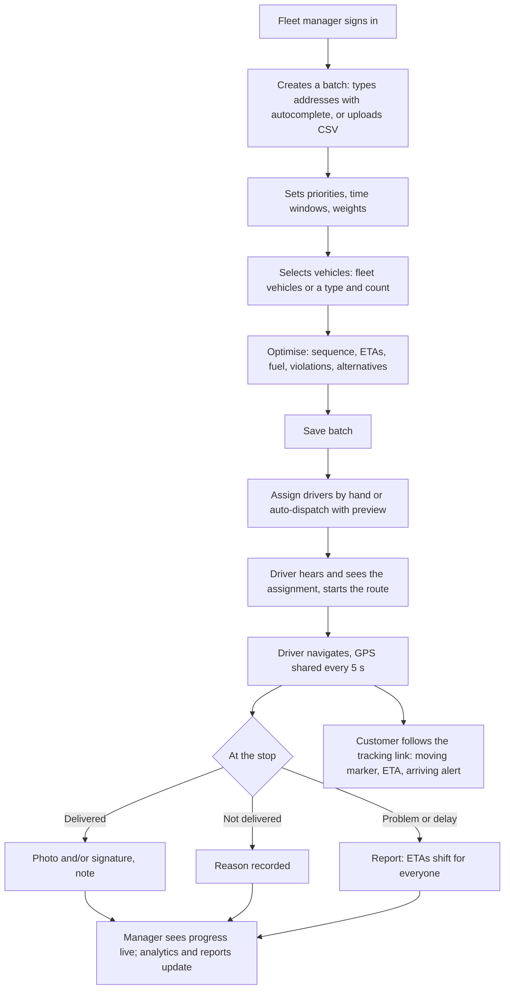

# Hopr: Product Requirements Document

**Product**: Hopr, a smart route optimization system for last-mile delivery
**Market**: delivery operators across India (demo data in New Delhi, Mumbai, Bengaluru, Kolkata and Ranchi)
**Collaborating organisation**: Unified Mentor
**Reference products**: Google Maps, Onfleet, Routific
**Status**: Phase 1 scope built and tested; deployment on free tiers
**Related**: [Technical documentation](TECHNICAL.md), [README](../README.md)

---

## 1. Problem

Last-mile delivery is the most expensive and least predictable stage of logistics. Small and mid-sized delivery operators across Indian cities still plan routes by hand or from static maps. The result:

- **Inefficient sequencing**: drivers visit stops in the order they were written down, not the order that is cheapest to drive.
- **Traffic delays**: plans ignore the morning and evening peaks on Main Road, Lalpur and Kanke Road, and road closures.
- **Rising fuel costs**: no one sees what a route costs in fuel, or that a motorbike would have done it for a third of the price.
- **Poor coordination between managers and drivers**: assignments go out over phone calls; managers cannot see who is where.
- **No real-time adjustment**: when traffic changes, the plan doesn't.
- **Limited analytics**: on-time rate, cost per delivery and vehicle utilisation are unknown, so they cannot be improved.

Customers feel it as late parcels and no idea when the driver will arrive.

## 2. Goals

### Primary objectives (from the specification)

| Objective | How Hopr meets it | Target |
|---|---|---|
| Optimise delivery routes using algorithm-based logic | Cost-based sequencing with 2-opt and relocate improvement, traffic-aware | Optimised plan is never worse than the order as entered (enforced by tests) |
| Reduce total travel distance and fuel consumption | Fuel cost in the objective, alternatives and savings shown on every plan | Savings in km and ₹ reported per route and in analytics |
| Improve on-time delivery rates | Delivery windows in the optimiser, live ETAs, delay reports | On-time rate measured per day and per period |
| Enable traffic-aware route adjustments | Indian-city traffic profile, incidents, recalculation from the driver's position | Affected routes flagged as soon as an incident is reported |
| Provide actionable insights for fleet managers | Dashboard alerts, live monitor, analytics with comparisons and CSV export | All six spec KPIs available with previous-period comparison |

### Secondary objectives

| Objective | How Hopr supports it |
|---|---|
| Improve vehicle utilisation | Capacity-aware batch planning; auto-dispatch prefers vehicles the load fits tightly; utilisation KPIs |
| Reduce carbon emissions | CO₂ per route and per period; comparison by vehicle type, including electric |
| Increase driver productivity | Clear next-stop view, one-tap navigation, proof of delivery in one dialog, spoken updates |
| Support multi-stop and multi-vehicle planning | Up to 30 stops per route and 10 vehicles (300 stops) per batch |

### Non-goals (out of scope for Phase 1)

Autonomous vehicles, drone delivery, GPS hardware, cross-border compliance. Also out of scope for this release: payments, customer accounts, and sending email or SMS.

## 3. Users

| Persona | Role in Hopr | Needs |
|---|---|---|
| **Sanjay, fleet manager** | `fleet_manager` | Turn a morning's orders into good routes fast, get them to drivers, see problems before customers call, report weekly numbers |
| **Ravi and Pooja, drivers** | `driver` | Know where to go next and by when, navigate, record deliveries with proof, flag problems without a phone call |
| **Anita, operations admin** | `admin` | Everything a manager can do, plus accounts, roles and system settings |
| **Arun, customer** | none (public link) | Know when the parcel will arrive and be home for it |

## 4. User flow

The specification's high-level flow, as built:

## 5. Functional requirements

Status: ✅ built and tested.

### 5.1 Route planning

| ID | Requirement | Acceptance criteria | Status |
|---|---|---|---|
| RP-1 | Manual entry of delivery addresses | Address search suggests places anywhere in India as you type, nearest the chosen hub first; choosing one fills the address and coordinates; unknown addresses cannot be optimised until located | ✅ |
| RP-2 | CSV upload | A CSV with an address column (plus optional customer, phone, priority, window, weight, size, notes) fills the stop list; a downloadable template is provided; malformed rows are reported | ✅ |
| RP-3 | Number and type of vehicles | Choose specific fleet vehicles (active only) or a vehicle type (bike, van, truck, electric van) and a count of 1–10 | ✅ |
| RP-4 | Priority setting | Each stop is urgent, standard or low; urgent stops are visited earlier when the time cost is small | ✅ |
| RP-5 | Optimised sequence | Plans 30 stops on one vehicle and 300 across 10 in under 10 s; never worse than the order as entered | ✅ |
| RP-6 | ETA calculation | Every stop shows an IST arrival time that accounts for traffic, service time and waiting for windows | ✅ |
| RP-7 | Delivery time windows | Optional from/to per stop; the plan meets windows where possible and flags any it can't, in plain words | ✅ |
| RP-8 | Capacity | Batches heavier than the selected fleet are refused with a reason; each vehicle stays within its capacity | ✅ |

### 5.2 Traffic and route monitoring

| ID | Requirement | Acceptance criteria | Status |
|---|---|---|---|
| TM-1 | Map API integration | Street maps, address search and road routing work with no paid key (OpenFreeMap, Photon, OSRM); Mapbox geocoding and directions are used when a server token is set | ✅ |
| TM-2 | Traffic-aware suggestions | Travel times follow an Indian-city hourly traffic profile; the same stops can be ordered differently at peak and off-peak | ✅ |
| TM-3 | Road closures and congestion | Managers report a closure or congestion zone on the map; routes crossing it are flagged | ✅ |
| TM-4 | Dynamic recalculation | Remaining stops can be re-optimised from the driver's current position at the current time | ✅ |
| TM-5 | Live monitoring | Every active route and driver on one map, refreshed every 10 s, with stale-GPS indication | ✅ |

### 5.3 Fuel optimisation

| ID | Requirement | Acceptance criteria | Status |
|---|---|---|---|
| FO-1 | Fuel per route | Litres (or kWh), ₹ cost and CO₂ for every route, from the vehicle's mileage and Indian fuel prices (set per state) | ✅ |
| FO-2 | Compare options by fuel efficiency | Each plan shows optimised, shortest-distance and as-entered options with distance, time, fuel and cost | ✅ |
| FO-3 | Vehicle type selection | Bike, van, truck and electric van, each with realistic capacity, speed and mileage | ✅ |
| FO-4 | Distance vs fuel cost | Distance and fuel cost shown side by side in the planner, route list, route detail and analytics | ✅ |
| FO-5 | Correct figures after reassignment | Moving a planned route to another vehicle recomputes ETAs and fuel for that vehicle | ✅ |

### 5.4 Driver interface

| ID | Requirement | Acceptance criteria | Status |
|---|---|---|---|
| DI-1 | View assigned route | The driver sees today's routes, the current stop, and all stops with status and ETA | ✅ |
| DI-2 | Map-based navigation | Route map with numbered stops; one tap opens turn-by-turn directions to the current stop | ✅ |
| DI-3 | Mark delivery status | Pending → in progress → completed (with a photo and/or signature) or failed (with a reason) | ✅ |
| DI-4 | Report issues or delays | Free-text issue or a delay in minutes; a delay shifts all remaining ETAs and the customer's tracking | ✅ |
| DI-5 | Phone-first | Large thumb-reach actions on phones; works at 375 px; installable to the home screen | ✅ |
| DI-6 | Spoken updates | New assignment, delivery outcomes and next stop are spoken; mute persists | ✅ |

### 5.5 Admin and fleet manager dashboard

| ID | Requirement | Acceptance criteria | Status |
|---|---|---|---|
| AD-1 | Create and manage delivery batches | Save, rename, cancel and delete batches and their routes; search and filter by status, batch or driver | ✅ |
| AD-2 | Assign vehicles and drivers | Assign by hand, or auto-dispatch with a preview of every pairing and its reasons before anything changes | ✅ |
| AD-3 | Track active deliveries | Dashboard fleet map, live monitor, route detail with proof of delivery | ✅ |
| AD-4 | Planned vs actual | Planned ETA vs actual delivery per stop; planned vs driven distance and time per route | ✅ |
| AD-5 | Reports and analytics | The six spec KPIs over 7, 30 or 90 days or a year, compared with the previous period, with trends and a CSV report | ✅ |
| AD-6 | Fleet and people | Vehicles (status, maintenance, driver), drivers (performance, activation), users and roles (admin) | ✅ |

### 5.6 Customer experience

| ID | Requirement | Acceptance criteria | Status |
|---|---|---|---|
| CX-1 | Live tracking link | A per-delivery link that needs no login and shows only that delivery | ✅ |
| CX-2 | Live driver position | The driver's marker moves smoothly along the road (never jumps), with a live "N min away" ETA | ✅ |
| CX-3 | Status timeline | Packed → On the way → Arriving (within 500 m) → Delivered, with a spoken "arriving" alert | ✅ |
| CX-4 | Honest staleness | If the driver's position is older than 60 s, the page says it is updating rather than showing a frozen marker as live | ✅ |

## 6. Non-functional requirements

| ID | Requirement | Target | Result |
|---|---|---|---|
| NFR-1 | Fast route computation | Under 10 s for batch planning | About 50 ms for 30 stops; about 480 ms for 300 stops on 10 vehicles |
| NFR-2 | Secure authentication | Industry-standard practice | bcrypt, JWT with revocation, lockout, layered rate limits, input validation, role checks on every endpoint, 0 known vulnerabilities |
| NFR-3 | High availability | 99% uptime | Not yet shown. Vercel and Atlas are highly available; Render's free plan sleeps when idle, and an UptimeRobot check every 5 minutes keeps it awake, with a public status page. Measured uptime to 28 Oct 2026 was about 81%, because the rate limiter answered Render's health check with 429; that is fixed, and the figure is to be re-measured |
| NFR-4 | Scalable architecture | Grows with the fleet | Stateless API, indexed queries, routing engine as pure functions; shared cache and rate-limit store needed only when running several instances |
| NFR-5 | Responsive UI | Mobile and desktop | Every page verified at 375 px and up to 1440 px |
| NFR-6 | Accessibility | Usable by keyboard and screen reader | Visible focus, skip link, labelled controls, dialog focus handling, reduced motion respected |
| NFR-7 | Cost | ₹0 | Free tiers and open services only: Vercel, Render, MongoDB Atlas M0, OpenFreeMap tiles, Photon geocoding, OSRM routing; Mapbox optional |

## 7. Data requirements

| Entity | Required fields (spec) | Additional fields in Hopr |
|---|---|---|
| Delivery | Delivery ID, customer name, address, priority, time window, package weight and size | Coordinates, phone, notes, status, planned and live ETA, proof of delivery, issues, tracking token |
| Vehicle | Vehicle ID, fuel type, mileage (km/l), capacity, assigned driver | Name, type, licence plate, status, maintenance dates, totals |
| Route | Total distance, estimated fuel, estimated delivery time, traffic impact factor, route status | Stops, depot, vehicle, driver, geometry, fuel cost, CO₂, violations, savings, live GPS, actuals |
| Driver | Driver ID, contact details, assigned vehicle, performance metrics | Account status, last known location |

**Data realism**: a hub and five real delivery points in each of New Delhi, Mumbai, Bengaluru, Kolkata and Ranchi, geocoded from OpenStreetMap; Indian retail fuel prices; India's grid emission factor for electric vehicles; vehicle profiles typical of Indian last-mile fleets (Hero Splendor+, Tata Ace, Tata Ace EV, Mahindra Jeeto, Tata 407) with state number plates. A one-click demo builds a five-stop morning route with real delivery windows in each city.

## 8. Key performance indicators

| KPI | Definition |
|---|---|
| Average delivery time | Minutes from route start to delivery, averaged |
| On-time delivery rate | Delivered within the window (or the promised ETA + 15 minutes) ÷ delivered |
| Fuel cost per delivery | Fuel cost of dispatched routes ÷ delivered stops |
| Route efficiency score | Planned km ÷ driven km, as a percentage (capped at 100) |
| Vehicle utilisation rate | Vehicles used ÷ active vehicles |
| Delivery completion rate | Delivered ÷ stops on dispatched routes |

All six appear in Analytics with the previous period for comparison. Delivered-today and on-time-today also appear on the dashboard.

## 9. Assumptions, constraints and risks

**Assumptions (from the specification)**

- Real-time traffic data is available: Hopr simulates Indian-city traffic deterministically, and managers report live congestion and closures as incidents.
- Drivers have GPS-enabled devices: the driver app shares location every 5 seconds, with manual fallbacks when GPS is denied.
- Address input is accurate: address search confirms every stop's location before planning.

**Constraints and how they are handled**

| Constraint | Handling |
|---|---|
| Traffic unpredictability | Incidents, recalculation from the current position, delay reports, live ETAs on the tracking page |
| API rate limits | Geocoding cached for 24 hours; curated landmarks answered locally; free OpenStreetMap fallback; Hopr's own API rate-limited per user |
| Fuel price fluctuations | Prices configurable per deployment through environment variables |
| ₹0 budget | Free tiers only; proof images stored in the database rather than paid object storage |

**Risks**

| Risk | Impact | Mitigation |
|---|---|---|
| Free API server sleeps when idle | First request after idle takes up to a minute | UptimeRobot pings `/api/health` every 5 minutes; the app explains any delay; paid plan when budget allows |
| Simulated traffic differs from a given day | ETAs off on unusual days | Incidents, recalculation and delay reports; live ETAs from GPS for customers |
| Geocoding quality in smaller towns | Wrong pin for an address | Results limited to India and ranked near the hub, curated places, and the planner shows every pin on a street map before optimising |
| Drivers without data coverage | Gaps in live tracking | Stale-location state on the tracking page; a failed action shows an error so the driver can try again |

## 10. Release plan

| Phase | Content | Status |
|---|---|---|
| 1. Gap analysis | Specification vs codebase review | Done |
| 2. Spec gaps and new features | Proof of delivery, live customer tracking, time windows, auto-dispatch, address autocomplete, spoken notifications, demo seeder | Done |
| 3. Design | A design system and redesign of every page, later replaced by the light "road signage" system | Done |
| 4. Testing | Unit and API tests (237) and end-to-end browser tests (20), end-to-end smoke test, zero console errors | Done |
| 5. Documentation and deployment | Technical documentation, PRD, README; Vercel + Render + Atlas | Documentation done; deployment needs the owner's accounts |
| 6. Product polish | Public homepage, demo morning, Hindi for drivers and customers, a driver app that works offline | Done |

## 11. Future enhancements

From the specification, with what already exists to build on:

| Enhancement | Starting point in Hopr |
|---|---|
| AI-based demand prediction | Delivery history by area and hour is already recorded |
| Electric vehicle optimisation mode | Electric van profile, kWh and grid CO₂ already modelled; add range and charging stops |
| Carbon tracking dashboard | CO₂ per route and per period already computed |
| E-commerce integration | Order webhooks that create stops through the existing planning API |
| Predictive maintenance analytics | Maintenance dates and distance driven per vehicle already recorded |
