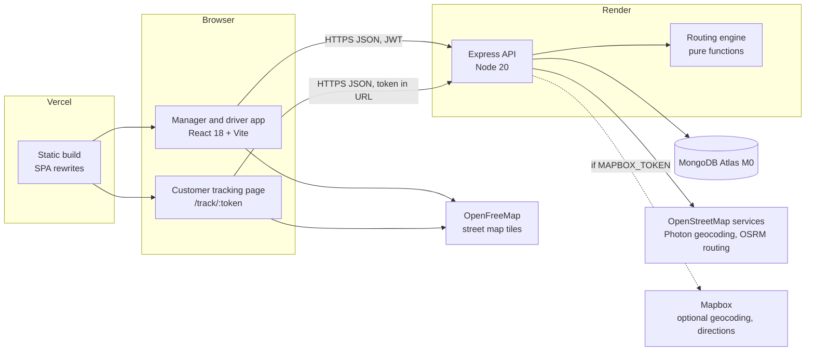

# Hopr technical documentation

Hopr is a route optimization system for last-mile delivery anywhere in India. Fleet managers plan multi-stop, multi-vehicle batches, dispatch them to drivers, and watch them live. Drivers follow the route, collect proof of delivery and report problems. Customers follow their parcel on a public tracking page.

This document maps the implementation to the project specification (*Smart Route Optimization System for Last-Mile Delivery*). Section numbers in the traceability table point to the parts of this document that cover each requirement.

- [1. Spec traceability](#1-spec-traceability)
- [2. Architecture](#2-architecture)
- [3. Data models](#3-data-models)
- [4. Routing algorithm](#4-routing-algorithm)
- [5. Traffic handling](#5-traffic-handling)
- [6. Fuel estimation](#6-fuel-estimation)
- [7. Dispatch, tracking and delivery features](#7-dispatch-tracking-and-delivery-features)
- [8. Authentication, roles and security](#8-authentication-roles-and-security)
- [9. API reference](#9-api-reference)
- [10. KPI definitions](#10-kpi-definitions)
- [11. Non-functional requirements](#11-non-functional-requirements)
- [12. Frontend](#12-frontend)
- [13. Testing](#13-testing)
- [14. Limitations and future work](#14-limitations-and-future-work)

---

## 1. Spec traceability

| Spec requirement | Where it lives | Section |
|---|---|---|
| Manual entry or CSV upload of delivery addresses | Route planner: stop editor with address autocomplete, CSV import with template | [12](#12-frontend) |
| Selection of number and type of vehicles | Planner: pick fleet vehicles, or a vehicle type and count (1–10) | [4.5](#45-multi-vehicle-batches) |
| Delivery priority (urgent/standard) | `priority: urgent \| standard \| low` per stop, weighted in the objective | [4.2](#42-objective-operating-cost-in-inr) |
| Optimized sequence and ETA calculation | `services/routeOptimizer.js` | [4](#4-routing-algorithm) |
| Map API integration (Google Maps / Mapbox) | Street maps with MapLibre GL and OpenFreeMap tiles (no key); geocoding and road directions from Mapbox when a token is set, otherwise from OpenStreetMap services | [2.4](#24-map-integration) |
| Traffic-aware suggestions, dynamic recalculation, closures and congestion | Simulated Indian-city traffic profile, manager-reported incidents, recalculation from the driver's position | [5](#5-traffic-handling) |
| Fuel per route, compare options, vehicle type, distance vs cost | `services/fuel.js`, route alternatives, per-type comparison | [6](#6-fuel-estimation) |
| Driver: view route, map navigation, mark Pending / Completed / Failed, report issues or delays | Driver panel, Google Maps hand-off, proof-of-delivery dialog, issue and delay reports | [7](#7-dispatch-tracking-and-delivery-features) |
| Manager: batches, assign vehicles and drivers, track deliveries, planned vs actual, reports | Routes and dispatch, auto-dispatch, live monitor, route detail, analytics with CSV export | [7](#7-dispatch-tracking-and-delivery-features), [10](#10-kpi-definitions) |
| Data requirements (delivery, vehicle, route, driver) | Mongoose models | [3](#3-data-models) |
| KPIs (6) | `services/analytics.js`, `services/metrics.js` | [10](#10-kpi-definitions) |
| NFRs: under 10 s planning, secure auth, availability, scalability, responsive UI | Measured and documented | [11](#11-non-functional-requirements) |
| 6–8 interconnected pages, role-based auth | 12 authenticated pages plus login and public tracking; 3 roles | [8](#8-authentication-roles-and-security), [12](#12-frontend) |
| Realistic data, not dummy data | Hubs and delivery points in five cities geocoded from OpenStreetMap, Indian fuel prices, Indian grid emission factor | [3.6](#36-reference-data), [6](#6-fuel-estimation) |

---

## 2. Architecture



### 2.1 Stack

| Layer | Choice |
|---|---|
| Frontend | React 18, Vite, React Router 7, Tailwind CSS 4, Chart.js, MapLibre GL JS, react-hot-toast |
| Backend | Node.js, Express, Mongoose, express-validator, multer, helmet, express-rate-limit, express-mongo-sanitize, bcryptjs, jsonwebtoken |
| Database | MongoDB (Atlas M0 in production; a local `mongod` in development and `mongodb-memory-server` in tests) |
| Tests | Vitest, Supertest, Testing Library, jsdom |
| Hosting | Vercel (frontend), Render free web service (API), MongoDB Atlas M0. Total cost ₹0 |

### 2.2 Repository layout

```
hopr/
├── backend/
│   ├── src/
│   │   ├── app.js              Express app: security middleware, rate limits, routers
│   │   ├── index.js            Startup: env checks, MongoDB connection, listen
│   │   ├── config/fleet.js     Vehicle profiles, fuel prices, emission factors, cost model
│   │   ├── data/               Geocoded hubs and places in five Indian cities
│   │   ├── middleware/         auth (JWT + roles), validation, uploads
│   │   ├── models/             User, Vehicle, Route (stops embedded), TrafficIncident, Upload
│   │   ├── routes/             One router per resource (see section 9)
│   │   ├── services/           routeOptimizer, routePlanning, traffic, fuel, dispatch,
│   │   │                       tracking, analytics, metrics, geometry, geocoding, demo,
│   │                       simulation (demo morning)
│   │   └── utils/              geo and IST time helpers
│   └── tests/                  API and unit tests against an in-memory MongoDB
├── frontend/
│   ├── public/                 Icons, web manifest and the offline service worker
│   ├── src/
│   │   ├── pages/              One component per screen
│   │   ├── components/         Map, dialogs, command palette, UI kit
│   │   ├── hooks/              Polling, driver location, offline sync, media query, page title
│   │   ├── i18n/               English and Hindi strings for drivers and customers
│   │   ├── offline/            Driver outbox, on-device storage, updates applied locally
│   │   ├── data/               The homepage's demo route
│   │   ├── context/            Auth session
│   │   └── utils/              API client, IST time, geo, tracking animation, speech, CSV
│   └── vercel.json             Rewrites client routes to index.html; no-cache for sw.js
└── docs/                       This document and the PRD
```

### 2.3 Request flow

1. The browser calls `/api/...` with `Authorization: Bearer <JWT>`. In development Vite proxies `/api` to the API; in production `VITE_API_URL` points at the Render service.
2. `app.js` applies helmet, CORS (only `FRONTEND_URL`), a 100 kB JSON limit, NoSQL-injection sanitising, security logging and the rate limiters (section 8.3).
3. The router validates input with express-validator, `authenticate` verifies the token and loads the user, and `authorize(...)` checks the role.
4. Planning endpoints call the routing engine (`services/routeOptimizer.js`), which is a set of pure, synchronous functions with no I/O. That keeps it deterministic and fast to test.
5. Errors return JSON. In production a 5xx says only "Internal server error"; stack traces are never sent.

### 2.4 Map integration

Hopr works across India with no paid key, and uses Mapbox when tokens are set: `MAPBOX_TOKEN` on the server and `VITE_MAPBOX_TOKEN` (a public `pk.` token) in the web app. One Mapbox public token works for both.

| Capability | Default (free, no key) | With Mapbox tokens |
|---|---|---|
| Map in the browser | MapLibre GL with OpenFreeMap tiles (OpenStreetMap data), English place names; a simplified SVG map if WebGL or the tiles are unavailable | Mapbox street tiles (Static Tiles API, light style) in the same map |
| Address search | OpenStreetMap Photon, limited to India | Mapbox Geocoding, limited to India, falling back to Photon |
| Road geometry | OSRM, the public routing service FOSSGIS runs for openstreetmap.org | Mapbox Directions with the `driving-traffic` profile, so routes and drive times reflect live traffic; the live drive time is saved with each route (`liveTrafficDriveMin`) and shown on the route page. Falls back to OSRM |
| Neither available | Straight legs × 1.35 circuity factor (typical for Indian city grids), drawn dashed | |

Address searches pass the batch's hub (`near=lng,lat`), so nearby places rank first while results can still come from anywhere in India. Curated places (the demo hubs and delivery points in Delhi, Mumbai, Bengaluru, Kolkata and Ranchi) lead when they match every word typed; a bare city or state name is left to the geocoder. Results are de-duplicated (same label, or within 30 m) and cached in memory for 24 hours; road geometry is cached too. Requests to the public OpenStreetMap services carry an identifying User-Agent and stay well within their fair-use policies.

---

## 3. Data models

All models are Mongoose schemas in `backend/src/models`. Each one is listed next to the spec's data requirements.

### 3.1 Delivery (a stop embedded in a route)

| Spec field | Field | Notes |
|---|---|---|
| Delivery ID | `deliveryId` | `DLV-XXXXXX`, generated |
| Customer name | `customerName`, `customerPhone` | |
| Address | `address`, `coordinates` | `[lng, lat]`, validated |
| Priority level | `priority` | `urgent`, `standard`, `low` |
| Delivery time window | `windowStart`, `windowEnd` | `HH:MM` in IST |
| Package weight / size | `packageWeightKg`, `packageSize` | `small`, `medium`, `large` |
| | `sequence`, `status` | status `pending`, `in_progress`, `completed`, `failed` |
| | `plannedArrival`, `estimatedArrival` | plan kept for planned-vs-actual; forecast updated live |
| | `windowStatus`, `lateByMin` | `on_time`, `early`, `late`, `none` |
| | `proofOfDelivery` | photo and signature (Upload refs), note, `completedAt`, `completedBy` |
| | `issues[]` | `issue` or `delay` (minutes), reporter and time |
| | `trackingToken` | 144-bit random token for the public tracking page |

### 3.2 Vehicle

| Spec field | Field |
|---|---|
| Vehicle ID | `vehicleId` (unique), `licensePlate` (unique) |
| Fuel type | `fuelType`: `diesel`, `petrol`, `electric`, `cng`, `hybrid` |
| Mileage (km/l) | `mileage`: km per litre, kg of CNG, or kWh |
| Capacity | `capacity` (kg) |
| Assigned driver | `driver` (User ref). Assigning moves the driver off any other vehicle |
| | `base`: the home hub (`name`, `address`, `coordinates`) where the vehicle starts its day; used by auto-dispatch and the planner |
| | `type` (`bike`, `van`, `truck`, `ev_van`), `status` (`active`, `maintenance`, `inactive`), maintenance dates, totals |

### 3.3 Route

| Spec field | Field |
|---|---|
| Total distance | `totalDistance` (planned km), `actualDistance` (km driven, from GPS) |
| Estimated fuel consumption | `fuelEstimate`, `fuelUnit`, `fuelPrice`, `fuelCost` (INR), `co2Kg` |
| Estimated delivery time | `estimatedTime` (min), `actualTime` |
| Traffic impact factor | `trafficImpactFactor` (traffic time ÷ free-flow time), `trafficLevel` |
| Route status | `status`: `planned`, `active`, `completed`, `cancelled` |
| | `routeId`, `batchId`, `stops[]` (1–30), `depot`, `vehicle`, `vehicleType`, `driver`, `plannedStart`, `startedAt`, `completedAt` |
| | `geometry` (GeoJSON LineString), `violations[]`, `savings`, `alternatives[]`, `loadKg`, `capacityKg` |
| | `driverLocation` (live GPS), `needsRecalculation`, `recalculations[]` |

Indexes: `{driver, status}`, `{vehicle}`, `{status}`, `{createdAt: -1}`, `batchId`, `stops.trackingToken`.

### 3.4 Driver (a User with role `driver`)

| Spec field | Field |
|---|---|
| Driver ID | `_id` |
| Contact details | `name`, `email`, `phone`, `address` |
| Assigned vehicle | the Vehicle whose `driver` is this user |
| Performance metrics | computed, not stored: deliveries, on-time rate, completion rate, average delivery time, distance (section 10) |
| | `role`, `isActive`, `lastLogin`, `lastLocation`, `failedAttempts`, `lockUntil`, `tokenVersion`, `notifications` |

### 3.5 Supporting models

- **TrafficIncident**: `type` (`congestion` or `closure`), `label`, `coordinates`, `radiusKm` (0.1–5), `severity` (1–4, a travel-time multiplier), `active`, `expiresAt`.
- **Upload**: proof photos and signatures stored in MongoDB (no paid storage). Fields: `kind`, `contentType` (`image/jpeg`, `image/png` or `image/webp`), `size`, `data` (not selected by default), `route`, `stopId`, `uploadedBy`.

### 3.6 Reference data

`backend/src/data/indiaCities.js` holds a hub and five real delivery points in each of five cities: New Delhi (Okhla), Mumbai (MIDC Andheri), Bengaluru (Bommanahalli), Kolkata (Kasba) and Ranchi (Kokar). `ranchiLocations.js` adds 16 Ranchi landmarks used by the tests. All coordinates were geocoded with OpenStreetMap (Photon and Nominatim), so every demo distance and ETA is a real city distance. The demo seeder builds one route per city from this data.

---

## 4. Routing algorithm

`backend/src/services/routeOptimizer.js`. One depot, up to 30 stops per vehicle, up to 10 vehicles per batch.

### 4.1 Travel model

- **Distance** between two points: great-circle distance × 1.35 road circuity for planning; the drawn route and its road distance come from OSRM or Mapbox Directions (section 2.4).
- **Free-flow time**: distance ÷ the vehicle's city speed (bike 28, van 24, truck 20, electric van 24 km/h).
- **Traffic**: free-flow time × the time-of-day factor at the moment the leg starts × any incident on the leg (section 5).
- **Service time** at each stop: bike 4, van 6, truck 10, electric van 6 minutes.
- **Windows**: arriving before `windowStart` means waiting; arriving after `windowEnd` is lateness.

### 4.2 Objective: operating cost in INR

Hopr does not minimise distance alone. It minimises what a route costs to run, which lets distance, traffic, fuel and priority trade off in one consistent unit:

```
cost = (drive + wait minutes) × ₹3                    driver time (about ₹180/h with overhead)
     + km × fuel cost per km of this vehicle           fuel efficiency
     + minutes after windowEnd × ₹30                   missed delivery windows
     + Σ minutes each stop waits from route start × weight
         weight: urgent ₹1.5, standard ₹0.15, low ₹0    delivery priority
```

Because traffic changes leg times, the same set of stops can be sequenced differently at 08:00 than at 14:00.

### 4.3 Search

1. **Up to 8 stops: exact.** Branch and bound over every visiting order. Every cost term only grows as stops are added, so a partial route that already costs more than the best complete one is dropped. The answer is the true optimum for the cost model.
2. **More than 8 stops:**
   - *Construction seeds*: greedy cheapest append (nearest neighbour on operating cost) and earliest deadline first (stops ordered by window end).
   - *Local search* on each seed until no move improves the cost: 2-opt (reverse a segment), Or-opt (move a chain of 1–3 stops, either way round) and swaps of two stops.
   - *Iterated local search*: kick the best route out of its local optimum (a double-bridge reconnection, alternating with a random reversal and relocation), improve it again, and keep it if it is cheaper. It stops after 30 + 2n kicks in a row without improvement, or at the time budget (3 s per route).
3. The cheapest result wins. The engine also returns three alternatives for comparison: *Hopr optimized*, *Shortest distance only*, and *Order as entered*. The savings shown to managers are optimized versus as entered.

The search is deterministic (its random kicks are seeded): the same input always gives the same route. The tests check it against brute force on real Ranchi stops, check that it is exactly optimal up to 8 stops and on a 9-stop case, and check that it is never worse than the previous search.

**Benchmark** ([BENCHMARK.md](BENCHMARK.md), reproducible with `npm run benchmark --workspace=backend`) on generated routes around the five demo hubs:
- **Small routes:** the optimum on every one of 75 routes with 6, 8 and 9 stops.
- **Shortest distance:** the exact shortest path (Held–Karp) on 29 of 30 routes with 12 and 15 stops, within 0.1% on the last.
- **15 to 30 stops:** 2–4% cheaper than the previous search on average, and never worse.
- **Speed:** a 30-stop route takes about 1.5 s.

### 4.4 Why at most 30 stops per route

This is a deliberate trade-off, documented rather than "fixed":

- Each local-search pass tries O(n²) moves, and every move re-simulates the route (traffic depends on arrival time), so a pass costs O(n³). Up to 30 stops the iterated search settles inside the 3 s budget (30 stops: about 1.5 s on average).
- Past about 30 stops, a single route stops being realistic for one vehicle on a working day in Indian city traffic (service time alone is 2–5 hours).
- Larger jobs are batches: split across vehicles first (4.5), so each route stays within the limit. One batch accepts up to 300 stops (30 × 10 vehicles).

### 4.5 Multi-vehicle batches

`planBatch` handles several vehicles at once:

1. **Partition**: a capacity-aware angular sweep around the depot. Stops are sorted by bearing, starting after the widest empty sector, then each vehicle is filled in turn up to an even share of stops, without exceeding its capacity or 30 stops.
2. **Improvement across vehicles** (up to 2 s): each vehicle gets a cost model over all the batch's stops, so any stop can be priced in any vehicle. The engine then moves a stop to another vehicle, or swaps two stops between vehicles, whenever the combined cost of the two routes drops. Each move is priced by inserting the stop at its cheapest position, and capacity and the 30-stop limit always hold. A vehicle may end up empty, which means the batch needs one vehicle fewer.
3. Each vehicle's stops are then optimised as in 4.3. Any vehicle whose stops changed is also optimised with its original stops, and the batch keeps whichever is cheaper, so the result is never worse than the sweep alone.
4. A batch heavier than the whole fleet is rejected with a clear message.
5. The batch budget is 7 s. The largest batch, 300 stops on 10 vehicles, uses about 6.5 s of it on the test machine; typical batches of 40–90 stops take 1–3.5 s.

On the benchmark (section 4 of [BENCHMARK.md](BENCHMARK.md)), moving stops between vehicles makes batches of 40–90 stops on 2–4 vans 1.5–4% cheaper and up to 5% shorter. It was better on 15 of 18 batches, the same on 3, and never worse.

### 4.6 Re-timing without re-sequencing

`retimeSequence` computes ETAs, window status and fuel for a fixed order. It is used when:

- **A planned route moves to another vehicle** (auto-dispatch or a manual change). Stops and distance stay the same; ETAs, windows, fuel, CO₂ and capacity follow the new vehicle. Example: a van route sent to a motorbike changes from ₹107.60 diesel to ₹30.34 petrol.
- **A driver starts a route.** Stops are forecast from the depot at the real start time with current traffic. Starting early helps stops without windows but never lands a stop before its window opens. Planned ETAs are kept for planned-vs-actual reporting.

### 4.7 On the spec's suggested algorithms

The spec suggests shortest-path algorithms (Dijkstra / A*) and multi-stop sequencing logic. Hopr splits the problem the same way:

- **Shortest path between two points** is a road-network problem. OSRM (or Mapbox Directions when configured) solves it on the real OpenStreetMap road graph, using contraction hierarchies, a Dijkstra-family method; when neither answers, Hopr uses the circuity estimate.
- **Shortest path around reported closures** is computed by Hopr itself with **A\*** on a visibility graph (5.2), with **Dijkstra** kept for comparison: both find the same path, and A* explores less.
- **Multi-stop sequencing** is a travelling-salesman problem with time windows (TSPTW), which Dijkstra and A* do not solve. Hopr solves small routes exactly and larger ones with construction plus iterated local search (2-opt, Or-opt, swaps), the standard practical approach at this size; the benchmark measures how close it gets.

---

## 5. Traffic handling

The spec allows API-based or simulated traffic. Hopr simulates it, which makes ETAs deterministic and testable and costs nothing.

### 5.1 Indian city weekday profile

Travel-time multiplier by hour (IST), from `services/traffic.js`:

| Hours | 00–05 | 06 | 07 | 08 | 09 | 10 | 11 | 12–14 | 15 | 16 | 17 | 18 | 19 | 20 | 21 | 22 | 23 |
|---|---|---|---|---|---|---|---|---|---|---|---|---|---|---|---|---|---|
| Factor | 1.00–1.05 | 1.15 | 1.30 | 1.55 | 1.60 | 1.45 | 1.30 | 1.25 | 1.30 | 1.40 | 1.60 | 1.65 | 1.50 | 1.35 | 1.20 | 1.10 | 1.05 |

The morning peak (school and office traffic) and the evening peak are the heaviest, a pattern shared by most Indian cities. The profile is one model for every city; managers report local congestion and closures as incidents (5.2). Sundays get 15% relief, but never below free-flow. Each leg uses the factor at the moment it starts, so a route that runs into the evening peak slows down part-way. Levels: light (below 1.25), moderate (1.25 to 1.5), heavy (1.5 and above).

### 5.2 Incidents: congestion and closures

Managers report incidents on the Live monitor (a point, a radius and a duration):

- **Congestion** multiplies the travel time of any leg passing through the zone by its severity (default 1.8).
- **Closure** forces a detour around the zone, with extra distance and time on every leg that crosses it. The detour is a real shortest path, not a rule of thumb. The closed circles become obstacles in a visibility graph whose nodes are the leg's two ends plus 16 points just outside each circle, with an edge wherever the straight line stays clear of every closure. **A\*** (heuristic: straight-line distance to the end, which never overestimates) finds the shortest way round. Several closures on one leg are handled together. Tests check the result against the exact geometry (two tangents and an arc, within 1%), and check that **Dijkstra** (the same search without the heuristic) finds exactly the same path while A* settles fewer nodes (`services/shortestPath.js`). A stop inside a closed area has no way round, so it is charged half of the circle instead.

When an incident is reported, every planned or active route crossing it is flagged `needsRecalculation` and shown on the dashboard and monitor.

### 5.3 Dynamic recalculation

`POST /api/routes/:id/recalculate` re-optimises the stops still to visit, from the driver's current position (live GPS, else the last finished stop, else the depot), at the current time, with today's traffic and active incidents. The previous and new finish times are recorded in `recalculations[]`.

A driver's **delay report** shifts every remaining ETA by the reported minutes, and the customer tracking pages follow automatically.

### 5.4 Travel times learned from the fleet

Free live-traffic data does not exist for Indian cities, so Hopr learns from its own drivers (`services/learnedTraffic.js`):
- **Recording:** each delivered leg on a real route compares the actual drive with the planned leg time. The actual drive is from leaving the previous stop (or the hub) to reaching this one, which is the delivery time minus the vehicle's time at the door. The result is stored as log(actual / planned) for the area (a 0.1° cell, about 11 km, around the route's hub) and IST hour. Legs more than 3× or less than 0.4× the plan are breaks or detours, not traffic, and are ignored. Simulated demo drives never count.
- **Using it:** once an area and hour has 5 legs, planning, re-timing on start and recalculation multiply that hour's traffic factor by the learned correction. It is blended in gradually, since 20 legs carry as much weight as the model itself, and it is bounded between 0.6 and 2.2, so a few odd trips cannot swing the ETAs.
- **Measuring it:** analytics reports arrival time accuracy, the average gap between the arrival time last given to the customer and the real arrival, plus the share within 10 minutes. It also reports how many legs have been learned and how many hour slots are in use.

---

## 6. Fuel estimation

`services/fuel.js`:

```
quantity = distance km ÷ mileage (km per L, kg or kWh)
cost (₹) = quantity × unit price
CO₂ (kg) = quantity × emission factor
```

| Type | Default mileage | Energy | Capacity | City speed |
|---|---|---|---|---|
| Motorbike | 45 km/L | petrol | 25 kg | 28 km/h |
| Delivery van | 16 km/L | diesel | 750 kg | 24 km/h |
| Light truck | 9 km/L | diesel | 2,500 kg | 20 km/h |
| Electric van | 7 km/kWh | electricity | 600 kg | 24 km/h |

A vehicle record's own mileage and capacity override the type defaults.

| Fuel | Default price (₹) | CO₂ per unit (kg) |
|---|---|---|
| Petrol | 97.90 / L | 2.31 |
| Diesel | 92.60 / L | 2.68 |
| CNG | 91.50 / kg | 2.75 |
| Electricity | 10.00 / kWh (depot tariff) | 0.71 (India grid, CEA) |

Prices are approximate Indian retail defaults (they vary by state) and can be overridden per deployment with `FUEL_PRICE_PETROL`, `FUEL_PRICE_DIESEL`, `FUEL_PRICE_CNG` and `FUEL_PRICE_ELECTRICITY`.

**Comparing options** (spec: "compare route options based on fuel efficiency", "distance vs estimated fuel cost"):

- Each plan returns the three alternatives from 4.3 with distance, minutes, fuel quantity, fuel cost, CO₂ and late stops.
- Each plan also returns a per-vehicle-type comparison: the same route by motorbike, van, truck and electric van, with fuel, cost, CO₂, time and whether the load fits.
- Fuel cost also enters the optimizer's objective, so cheaper-to-drive orders win when time is equal.

---

## 7. Dispatch, tracking and delivery features

### 7.1 Assignment and auto-dispatch

Managers can assign a driver and vehicle to any planned route by hand, or press **Auto-dispatch**. `services/dispatch.js` scores every (route, available driver with a vehicle) pair:

```
score = 0.6 × proximity + 0.4 × capacity fit (+ 0.05 if the vehicle type matches the plan)
proximity    = 1 / (1 + km from the driver to the route start ÷ 3)
capacity fit = load ÷ capacity (vehicles that are too small are excluded)
```

The driver's position is their last GPS fix if it is under 12 hours old, else their vehicle's home hub, else (unknown) the route's own hub. A driver more than 75 km from the route's start is in another city and is never offered the route; the preview says why (for example "Pooja Kumari is 990 km away (based at Hopr Hub, Okhla)"). Matching is greedy best-pair: one route per driver and per vehicle, with deterministic tie-breaks. The manager sees a preview ("Route A → Driver X", score and reasons) and confirms. On confirm every pair is re-validated, so a stale preview cannot double-book anyone.

### 7.2 Driver workflow

Starting a route forecasts the ETAs (4.6). The driver panel shows:
- the current stop, with plain-language timing ("in 12m" or "running at least 25m late") and the window state (opens in, open until, closed at)
- navigation (a Google Maps hand-off)
- call and share-tracking buttons
- on phones, a dock with Navigate, Couldn't deliver and Delivered

The panel also announces assignments and outcomes aloud. It keeps working without signal (7.8) and can be read in Hindi (7.9).

### 7.3 Proof of delivery (F1)

Completing a stop opens a dialog with a photo (camera or file), a signature pad and an optional note; at least a photo or a signature is required. Uploads go through multer memory storage, with these limits:
- at most 5 MB per image and 2 files per request
- the type is checked from the file's own bytes (JPEG, PNG or WebP), not its name

They are stored in MongoDB with `completedAt` and `completedBy`. Proof images can be read only by managers and the route's driver, and are deleted with their route. Managers can complete a stop without proof; drivers cannot.

### 7.4 Live customer tracking (F2)

- **Driver side**: while a route is active the driver app sends GPS every 5 seconds (`PATCH /api/routes/:id/location`), with "Update location" and "Pick on map" fallbacks and a demo drive mode. The demo drive stops at the next undelivered stop. The server ignores GPS jitter and implausible jumps when adding up driven distance.
- **Customer side**: `/track/:token` needs no login; the random per-stop token is the only credential. It shows:
  - the driver's initials, smoothly animated along the remaining route (it never teleports), with the remaining-route line
  - a live "N min away" ETA
  - a timeline: Packed, On the way, Arriving (within 500 m), Delivered
  - a "stale" state after 60 seconds without a ping
- **Privacy**: the tracking response contains no other customers' stops and no contact details.

### 7.5 Delivery time windows (F3)

Optional `windowStart` and `windowEnd` per stop. The objective penalises lateness heavily (₹30 a minute) and the search includes an earliest-deadline seed, so ETAs land inside windows where possible. Windows that cannot be met are flagged in plain language (for example "Stop 4 ETA 16:20, window ends 16:00"), and the planner and route detail show each stop's ETA against its window.

### 7.6 Address autocomplete (F5) and spoken notifications (F6)

- **Autocomplete**: search as you type (debounced, keyboard accessible); see 2.4 for the providers. Choosing a result fills the address and coordinates.
- **Spoken notifications**: a dependency-free `speak()` using the Web Speech API (English voice, or a Hindi voice for drivers and customers reading in Hindi; rate 1, cancels speech in progress, silent where unsupported). It speaks when a route is assigned, a delivery is completed or failed, auto-dispatch finishes, and the customer's driver is arriving or has delivered. Mute is a header toggle persisted in `localStorage`; visual toasts always appear too.

### 7.7 Demo morning

The dashboard can drive the demo routes so the product can be watched working without anyone holding a phone. `POST /api/demo/simulate` auto-dispatches the waiting demo routes (the same matching as 7.1), then starts every planned demo route as a simulated drive at 20 times real time. A server ticker (every 2 s) moves each van along its road geometry at the vehicle's speed, adjusted for the traffic profile, waits the service time at each stop, and completes stops with a "Demo delivery (simulated)" note. The position is derived from the start time, so a restarted server resumes at the right place. ETAs and the customer's countdown follow the simulated clock, and the tracking page says it is a demo. Only routes flagged `isDemo` are ever simulated. Before anyone is on the road, the dashboard map shows the day's planned routes and the hubs; the zoom button beside each driver follows one route.

### 7.8 Working offline (driver app)

Drivers lose signal often, so the driver app does not depend on it:
- **Outbox**: starting a route, Delivered (with the photo and signature), Couldn't deliver and reports are sent at once when possible. With no connection, or a gateway answering 502–504 for a sleeping server, they are saved in IndexedDB on the phone and applied to the screen straight away, marked "Waiting to send". They are sent in order when the phone comes back online, every 20 s while any are waiting, or with "Send now".
- **Time it happened**: each update carries `at`. The server uses it for `startedAt`, `completedAt` and `failedAt` when it is within the last 24 hours and not in the future; otherwise it uses the time received. A repeat of an update the server already applied is refused with 409 and dropped from the outbox, so nothing is counted twice.
- **Opening offline**: the driver's last-loaded routes and their name and role are kept on the device, and a service worker (production builds) caches the app, the typeface and recently viewed map tiles (up to 600). API responses are never cached by the service worker.
- **Privacy**: cached routes and the remembered driver are cleared on sign-out. Unsent updates are kept for that driver, and signing out with updates waiting asks for confirmation first.

### 7.9 Hindi for drivers and customers

The driver's screens (dashboard, My deliveries, dialogs, sidebar and header) and the customer tracking page can be switched between English and Hindi. The choice is remembered on the device, and Hindi is the default when the browser prefers it. Strings live in `frontend/src/i18n/strings.js`; a test checks that every English string has a Hindi version with the same placeholders. Values the server stores in English, such as failure reasons and vehicle types, are translated for display only, so managers still read them in English. Manager screens are English only.

### 7.10 Email notifications and proof retention

- **Email** goes through Resend's HTTP API (free tier, 3,000 a month) when `RESEND_API_KEY` and `EMAIL_FROM` are set; otherwise nothing is sent. Each person's profile settings decide what they get:
  - *Route changes*: drivers get new route assignments. Managers get failed deliveries (with the reason), finished routes, and new drivers waiting for approval.
  - *Vehicle maintenance*: managers get one alert per service date, 3 days ahead.
  - *Weekly report*: a Monday-morning summary of last week's figures.

  Emails are sent in the background, one per person so addresses stay private. Demo routes and the shared demo accounts never get email. SMS is shown as unavailable, because SMS in India needs a registered (DLT) sender, which is not free.
- **Proof retention**: a TTL index deletes proof photos and signatures `PROOF_RETENTION_DAYS` after upload (default 90; 0 keeps them forever), so the free 512 MB database does not fill up. The delivery record keeps its time, driver and note, and the app says when an image is no longer stored.

---

## 8. Authentication, roles and security

### 8.1 Authentication

- **Passwords**: bcrypt with cost 12; never returned by the API.
- **Tokens**: JWT signed with `JWT_SECRET`; 7-day expiry (a documented trade-off). In production the server refuses to start without `JWT_SECRET`.
- **Revocation**: every token carries the user's `tokenVersion`. Changing a password, or an admin resetting it, increments the version and signs out every existing session, including the current one.
- **Lockout**: five failed logins lock the account for 15 minutes. The sixth attempt is refused with 429, even with the right password.
- **Session storage**: the token lives in `localStorage` (a documented trade-off: simple, and no CSRF surface, at the cost of XSS exposure, mitigated by React's escaping and helmet's headers). Only a 401 ends a session in the browser; a rate limit or network failure shows a retry screen instead of signing the user out.
- **Registration**: public sign-up always creates a driver, whatever role is sent. Only admins create admins and fleet managers.

### 8.2 Roles

| Capability | Admin | Fleet manager | Driver |
|---|---|---|---|
| Plan, save, edit, cancel and delete routes | ✓ | ✓ | |
| Assign drivers and vehicles, auto-dispatch | ✓ | ✓ | |
| Live monitor, report incidents | ✓ | ✓ | |
| Vehicles: create, edit, assign | ✓ | ✓ | |
| Delete vehicles | ✓ | | |
| Drivers: list, performance, activate | ✓ | ✓ | |
| Analytics and CSV reports | ✓ | ✓ | |
| Users: create any role, edit, deactivate, delete | ✓ | | |
| Own assigned routes: start, deliver, fail, report issues, send GPS | | | ✓ |
| Profile, password, notification settings | ✓ | ✓ | ✓ |

Drivers can read only their own routes and proof images. Managers can complete a stop without proof; drivers must provide a photo or signature. An admin cannot delete or deactivate their own account.

### 8.3 Security controls

| Control | Implementation |
|---|---|
| HTTP headers | helmet on the API; on the website (`vercel.json`, also applied by `vite preview`) a Content Security Policy allowing only the site (the typeface is self-hosted), the API (`*.onrender.com`), OpenFreeMap tiles and, when error tracking is on, Sentry, plus `X-Frame-Options: DENY`, `nosniff`, a strict referrer policy (tracking tokens never leave in a Referer), a permissions policy and HSTS. If the API is hosted elsewhere, add its origin to `connect-src` |
| CORS | only `FRONTEND_URL` |
| Body size | 100 kB JSON / form; images 5 MB |
| NoSQL injection | express-mongo-sanitize; search text is regex-escaped |
| Mass assignment | explicit field whitelists on every write |
| Input validation | express-validator on every route; malformed IDs return 400, not 500 |
| Rate limiting | see below |
| Errors | no stack traces or internals in production responses |
| Security logging | 401 and 429 responses, account lockouts and admin changes are logged |
| Uploads | file type from magic bytes, size and count limits, private by default |
| Sign-in tokens | HS256 only, pinned when signing and verifying |
| Demo mode | the demo endpoints exist only with `DEMO_MODE=true`, so without it no one can create the demo accounts (whose passwords are published) through the API. In demo mode the demo accounts cannot be edited, deactivated, deleted or locked out, even by the demo admin |
| Planning tools | address search, geocoding and road routing (`/api/map`) are for managers only, so a self-registered account cannot use the server as a free proxy |
| Tracking links | stop working 48 hours after the delivery is finished (410) |
| Offline updates | a time sent by the driver app is trusted only within 24 hours and never in the future; updates that arrive more than 2 minutes late also keep `receivedAt`, shown on the route as recorded without signal. Updates unsent after 7 days are dropped from the phone |
| Dependencies | `npm audit` reports 0 vulnerabilities in both workspaces |

Rate limits (per signed-in user, or per IP when anonymous):

| Traffic | Limit |
|---|---|
| General API | 100 requests per 15 minutes |
| Login, register, password changes | 20 per 15 minutes per IP, plus the account lockout |
| Driver GPS pings | 30 per minute |
| Public tracking page | 30 per minute per IP |
| Live reads (dashboard, routes, incidents) | 60 per minute |

Behind Render's proxy, `TRUST_PROXY` (on by default in production) makes the limits see the real client IP.

---

## 9. API reference

Base path `/api`. All bodies are JSON unless noted. "Manager" means admin or fleet manager. Errors return `{ "message": "..." }` with a 4xx or 5xx status.

### Auth (`/api/auth`)

| Method | Path | Access | Purpose |
|---|---|---|---|
| POST | `/register` | public | Create an account (always role `driver`). Body: `name`, `email`, `password`, `phone?`. Returns `{ token, user }` with 201 |
| POST | `/login` | public | Body: `email`, `password`. Returns `{ token, user }`. 401 for wrong credentials, 429 when locked |
| GET | `/me` | signed in | The current user |
| PUT | `/profile` | signed in | Update `name`, `email`, `phone`, `address` |
| PUT | `/password` | signed in | Body: `currentPassword`, `newPassword`. Every session, including this one, is signed out and must log in again |
| PUT | `/notifications` | signed in | Notification preferences |

### Routes (`/api/routes`)

| Method | Path | Access | Purpose |
|---|---|---|---|
| POST | `/optimize` | manager | Plan without saving. Body: `stops[]` (1–300), `vehicleIds[]` or `vehicleType` + `vehicleCount`, `departureTime`, `depot?`, `trafficEnabled?`, `returnToDepot?`. Returns routes with sequence, ETAs, violations, totals, alternatives |
| POST | `/` | manager | Plan and save a batch. Same body plus `name`, `assignments[]`. Figures are recomputed on the server; client totals are ignored |
| GET | `/` | signed in | List. Query: `status`, `driver`, `vehicle`, `batchId`, `unassigned`, `withGeometry`, `page`, `limit` (≤100). Drivers see only their own |
| GET | `/driver/assigned` | driver | The driver's planned and active routes |
| GET | `/:id` | manager or the route's driver | Full route with stops, proof, geometry |
| PATCH | `/:id` | manager | Rename, assign or unassign `driver` and `vehicle` (a planned route is re-timed for a new vehicle), cancel or restore (`status`) |
| PATCH | `/:id/start` | the route's driver or a manager | Start: status `active`, ETAs forecast from now. `at?` for a start made offline (7.8) |
| PATCH | `/:id/stops/:stopId/status` | the route's driver or a manager | `in_progress`, `completed` (managers only without proof) or `failed` with `reason`; `at?` as above |
| POST | `/:id/stops/:stopId/complete` | the route's driver or a manager | Proof of delivery, `multipart/form-data`: `photo?`, `signature?`, `note?`, `at?`; at least one image |
| POST | `/:id/stops/:stopId/issues` | the route's driver or a manager | Body: `type` (`issue` or `delay`), `description`, `delayMinutes?` (a delay shifts remaining ETAs) |
| PATCH | `/:id/location` | the route's driver | GPS ping: `coordinates`, `accuracy?`, `heading?`, `speed?` |
| POST | `/:id/recalculate` | the route's driver or a manager | Re-optimise remaining stops from the current position |
| DELETE | `/:id` | manager | Delete a route and its proof images |

### Dispatch (`/api/dispatch`)

| Method | Path | Access | Purpose |
|---|---|---|---|
| POST | `/preview` | manager | Proposed pairs with scores and reasons, plus routes that cannot be placed and why |
| POST | `/confirm` | manager | Body: `assignments[]` of `{ route, driver, vehicle }`. Re-validated; returns `{ assigned, skipped }` |

### Vehicles (`/api/vehicles`)

| Method | Path | Access | Purpose |
|---|---|---|---|
| GET | `/` | manager | List. Query: `status`, `fuelType`, `search`, `page`, `limit` |
| GET | `/available` | manager | Active vehicles without a driver |
| GET | `/:id` | manager | One vehicle |
| POST | `/` | manager | Create (`vehicleId`, `name`, `type`, `fuelType`, `mileage`, `capacity`, `licensePlate`, `status`, `driver?`, `base?` home hub, dates). 409 on a duplicate plate or ID |
| PUT | `/:id` | manager | Update |
| PATCH | `/:id/assign-driver` | manager | Body: `driverId` or `null` |
| DELETE | `/:id` | admin | Refused (409) while the vehicle is on a planned or active route |

### Drivers (`/api/drivers`)

| Method | Path | Access | Purpose |
|---|---|---|---|
| GET | `/` | manager | Drivers with vehicle, active route and performance metrics. Query: `search`, `page`, `limit` |
| GET | `/available` | manager | Active drivers, marking those already on a route |
| GET | `/:id` | manager | One driver with metrics |
| PATCH | `/:id/status` | manager | Activate or deactivate a driver |

### Live operations

| Method | Path | Access | Purpose |
|---|---|---|---|
| GET | `/api/dashboard` | signed in | Role-specific summary: today's KPIs, live routes, counts behind the attention alerts (waiting routes, traffic changes, incidents), recent routes, and for managers `demo` (waiting and running demo drives) |
| GET | `/api/incidents` | signed in | Active incidents |
| POST | `/api/incidents` | manager | Report `congestion` or `closure` with `coordinates`, `radiusKm`, `severity`, `durationMinutes`; flags affected routes |
| PATCH | `/api/incidents/:id/resolve` | manager | Resolve an incident |
| GET | `/api/track/:token` | public | Customer tracking: status, timeline, delivery, driver initials and first name, vehicle type, location, remaining path, ETA, and `demo` during a demo drive. 410 two days after the delivery is finished |
| GET | `/api/uploads/:id` | manager or the route's driver | A proof photo or signature |

### Analytics and admin

| Method | Path | Access | Purpose |
|---|---|---|---|
| GET | `/api/analytics` | manager | KPIs, previous-period comparison, daily trends, status breakdown, vehicle utilisation. Query: `range` = `7d`, `30d` (default), `90d` or `1y` |
| GET | `/api/analytics/report.csv` | manager | Route-level CSV report. Cells are escaped and formula-neutralised |
| GET | `/api/admin/users` | admin | List users. Query: `role`, `search`, `page`, `limit` |
| POST | `/api/admin/users` | admin | Create a user with any role |
| GET / PUT / DELETE | `/api/admin/users/:id` | admin | Read, update (a password reset signs the user out), delete |
| PATCH | `/api/admin/users/:id/status` | admin | Activate or deactivate |
| GET | `/api/demo/status` | public | `{ enabled }`: whether the server runs in demo mode (the web app shows its demo buttons only then) |
| POST | `/api/demo/seed` | manager, demo mode | Idempotent demo data: accounts, a driver and vehicle based at a hub in each of five cities, and a fresh five-stop route with windows in each city (Ranchi assigned to the demo driver, the rest waiting for auto-dispatch) |
| POST | `/api/demo/simulate` | manager, demo mode | Demo morning (7.7): dispatch and drive the planned demo routes at 20 times real time. 409 when none are waiting |
| DELETE | `/api/demo/simulate` | manager, demo mode | Stop the demo drives where they are |

### Maps (`/api/map`, managers)

| Method | Path | Purpose |
|---|---|---|
| GET | `/config` | Map centre, the hubs the fleet is based at (planner quick picks), which geocoder is active |
| GET | `/suggest?q=&limit=&near=lng,lat` | Address suggestions across India, ranked near `near` (section 2.4) |
| GET | `/geocode?address=` | First match for an address |
| GET | `/reverse-geocode?lng=&lat=` | Address for a point |
| GET | `/directions?coordinates=` | Road geometry and distance from OSRM or Mapbox (`source`: `osm`, `mapbox` or `estimated`) |

`GET /api/health` returns `{ status: "ok" }` for uptime checks.

---

## 10. KPI definitions

All KPIs come from recorded deliveries; nothing is simulated. The analytics window runs to the end of the current IST day. A route counts in a period if it was planned, started or completed in it.

| KPI (spec) | Definition |
|---|---|
| Average delivery time | Minutes from the route starting to each parcel being delivered, averaged |
| On-time delivery rate | Delivered stops completed by their window end (or, without a window, by the promised ETA + 15 minutes) ÷ delivered stops |
| Fuel cost per delivery | Fuel cost of dispatched routes ÷ delivered stops |
| Route efficiency score | Planned km ÷ driven km × 100 (capped at 100), averaged over completed routes with GPS distance |
| Vehicle utilization rate | Distinct vehicles used ÷ active vehicles × 100 |
| Delivery completion rate | Delivered stops ÷ stops on dispatched routes × 100 |
| Arrival time accuracy (added) | Average of \|real arrival − last arrival time given to the customer\| in minutes, where real arrival = delivery time − the vehicle's time at the door; plus the share within 10 minutes. Demo routes excluded |

Also reported: capacity utilisation (load ÷ capacity), total distance, fuel cost and CO₂, kilometres and rupees saved by optimisation, and the change against the previous period of the same length. When there is no data a KPI shows "—" rather than an invented number.

---

## 11. Non-functional requirements

| Requirement | Status | Evidence |
|---|---|---|
| Fast route computation, under 10 s for batch planning | Met | 30-stop route in about 50 ms; 300 stops on 10 vehicles in about 480 ms (hard budgets: 3 s per route, 7 s per batch). Covered by tests |
| Secure user authentication | Met | Section 8: bcrypt, JWT with revocation, lockout, rate limits, validation, audit logging, 0 known vulnerabilities |
| High availability (99% uptime) | Met on the ₹0 budget | Atlas M0 and Vercel are highly available. Render's free plan sleeps after 15 minutes idle; an UptimeRobot monitor requests `/api/health` every 5 minutes, which keeps it awake, alerts by email when it is down and publishes the record on a [public status page](https://stats.uptimerobot.com/NK50eDGlfC). If the server does sleep, the app tells the user after 4 seconds that it is waking. A paid Render instance removes the limitation entirely |
| Scalable architecture | Met for this scope | Stateless API (JWT), indexed queries, routing engine as pure functions, so instances can scale horizontally. Rate-limit counters and the geocoding cache are in memory per instance; across several instances they would move to a shared store such as Redis |
| Responsive UI | Met | Every page verified at 375 px wide (no horizontal scroll) and on desktop up to 1440 px; phone-specific driver dock and bottom-sheet dialogs |

Accessibility: keyboard focus is always visible, there is a skip link, dialogs trap focus and close with Esc, and the command palette uses combobox/listbox semantics. Reduced-motion preferences turn animation off.

---

## 12. Frontend

### 12.1 Screens

| Screen | Path | Roles |
|---|---|---|
| Homepage | `/` | public (signed-in users go to their dashboard) |
| Login and registration | `/login` | public |
| Dashboard | `/dashboard` | all (role-specific content) |
| Route planner | `/route-planner` | manager |
| Routes and dispatch | `/routes` | manager |
| Route detail | `/routes/:id` | manager, the route's driver |
| Live monitor | `/monitor` | manager |
| Vehicles | `/vehicles` | manager |
| Drivers | `/drivers` | manager |
| My deliveries (driver panel) | `/driver-panel` | driver |
| Analytics | `/analytics` | manager |
| Admin | `/admin` | admin |
| Profile | `/profile` | all |
| Customer tracking | `/track/:token` | public |

### 12.2 Building blocks

- **Design system, "road signage"**: a light, plain interface. White panels on a light grey canvas, ink text, and colour used only for meaning: highway-sign green (#0B6B3A) for routes, the main action and the active page; city-sign blue for links and live drivers; road-marking yellow for warnings; red for failures. Overpass type throughout (from the highway sign alphabet's lineage). The one distinctive element is the road sign itself: route IDs and stop numbers drawn as route plates, a direction sign on the sign-in page, and the logo. No glow, glass, gradients or entrance animation. Tokens live in `tailwind.config.js` and `index.css`; a living style guide is at `/design-system` in development builds.
- **MapView**: MapLibre GL with OpenFreeMap street tiles (no key), routes drawn with a white casing like a road map, English place names, and an all-India starting view. If WebGL or the tiles are unavailable it falls back to a simplified SVG map with the same API (lines, markers, drivers, incidents, map clicks).
- **Command palette** (⌘K / Ctrl K, or `/`): jump to any page or route and run actions such as auto-dispatch.
- **Homepage**: the New Delhi demo route on its real roads, driven by a van beside a route sheet that keeps time (still under reduced motion), how it works, the three people who use it, coverage, and a one-click demo sign-in.
- **Polling** (`usePolling`): pauses or slows in background tabs. Dashboard every 30 s (4 s during a demo morning), fleet map 15 s (3 s while anyone is on the road), routes 20 s, live monitor 10 s, tracking page 5 s.
- **Languages and offline**: see 7.8 and 7.9.
- **Resilience**: error boundaries with a recovery screen, a session-retry screen on 429 or network failure, skeleton loaders with a "server waking up" notice, and proof photos cached for the session.
- **IST everywhere**: all operational times are shown in Indian Standard Time regardless of the viewer's device.
- **Installable**: web manifest and icons, so drivers can add Hopr to their home screen.

---

## 13. Testing

```bash
npm test --workspace=backend    # 157 tests, in-memory MongoDB
npm test --workspace=frontend   # 51 tests, jsdom
npm run test:e2e                # 16 Playwright tests in a real browser
npm run lint --workspace=backend && npm run lint --workspace=frontend
npm run build --workspace=frontend
```

GitHub Actions (`.github/workflows/ci.yml`) runs lint, every unit and API test, the build, `npm audit` and the end-to-end tests on every pull request and every push to `main`.

| Area | Tests | Highlights |
|---|---|---|
| Routing engine | 22 | Exactly optimal up to 8 stops and on a 9-stop case, never worse than the previous search, the same plan every time; brute-force-verified optimal order on 5 Ranchi stops; urgent stops earlier; windows (wait, flag, readable violation); rush hour vs night; incidents; fuel and CO₂; 30-stop limit; 300-stop batch under 10 s |
| Auth | 10 | Register 201; admin role forced to driver; login 200; `/me` 200 with token and 401 without; lockout on the sixth bad login; tokens revoked on password change; profile whitelist; session checks not counted against the auth limit |
| Authorisation | 8 | Drivers limited to their own routes; manager and admin boundaries; regex-safe search; 400 for malformed IDs |
| Routes and workflow | 15 | Planning API, batches, assignment, end-to-end driver workflow, delays, recalculation, incidents, re-timing on vehicle change and on start |
| Auto-dispatch | 10 | Proximity, stale GPS fallback, home hub position, never another city, capacity fit and exact score formula, global matching, preview and confirm with re-validation |
| Proof of delivery | 9 | Photo, signature and note; type sniffing; 5 MB limit; privacy; deletion with the route |
| Tracking | 10 | GPS pings and odometer filtering, dedicated rate limit, public page states, privacy |
| Analytics | 8 | Every KPI formula, empty data, period comparison, CSV safety |
| Fleet, maps, demo, health, geocoding | 24 | Vehicles and drivers, geocoding validation, five-city demo seeder (including late at night) and city-by-city auto-dispatch, security headers, India-wide place matching, ranking near a hub, de-duplication |
| Demo morning | 4 | Drive timeline (speed, time at the door), dispatch and drive of all five cities, ETAs and tracking on the simulated clock, never real routes, stop, managers only |
| Security fixes | 9 | No demo endpoints without demo mode (a manager cannot create the known admin), demo accounts cannot be changed, deleted or locked out, planning tools for managers only, HS256 only, tracking links expire, late offline updates keep `receivedAt` |
| Learned travel times | 6 | Leg timing against the plan, breaks and detours ignored, gradual and bounded correction, slower drives lead to later ETAs, demo drives never teach it, arrival accuracy |
| Email, retention, approval, cross-van moves | 12 | Emails follow each person's settings and never reach demo accounts, one maintenance alert per date, Monday report once, nothing without a key; images expire after 90 days and the record stays; sign-ups wait for approval outside demo mode; moving stops between vans is never worse and keeps capacity; weekday and Sunday learning |
| Shortest paths and Mapbox | 6 | A* around closures within 1% of the exact geometry, A* and Dijkstra agree with A* exploring less, no way round from inside a closure, real detours charged to legs, Mapbox `driving-traffic` requested and its drive time kept |
| Offline updates | 3 | Time it happened trusted only within a day and never in the future, start, failure and delivery recorded at those times, repeat refused |
| Frontend | 51 | Tracking animation never teleports, geo helpers, CSV import, speech (including Hindi), stop timing, session retry on 429, confirm dialog, error boundary, command palette, image cache, every Hindi string present, offline outbox order, retry rules and week-old updates dropped, updates applied on the phone |

**End-to-end tests (Playwright, 16).** These run against a production build and a throwaway in-memory database, at desktop size and at phone size for the driver and customer screens. They cover:
- a visitor opening the demo from the homepage
- planning from a spreadsheet, saving and auto-dispatching
- a driver delivering with a drawn signature
- a delivery made offline, held on the phone and sent on reconnect
- customer tracking switched to Hindi, and an unknown tracking link
- axe accessibility checks (WCAG 2.1 AA) on the homepage, sign-in, tracking, every manager screen and the driver panel. Any serious or critical issue fails the run.

Lighthouse on the production build (phone, then desktop; performance, accessibility, best practices and SEO):
- homepage: 88–93/100/100/100 and 100/100/100/100 (phone performance varies between runs; on phones the street map loads on the first touch or scroll)
- customer tracking: 76–91/100/100 on a phone (SEO is low on purpose: `robots.txt` keeps tracking links out of search engines)
- sign-in: 89/100/100/100 and 100/100/100/100

An end-to-end smoke test on the development servers passed every step: register, log in as each role, plan a five-stop route with windows using address autocomplete, create a vehicle and a driver, auto-dispatch, complete a stop with photo and signature, follow the tracking page as the marker moves and "arriving" is spoken, and view analytics. It finished with zero console errors.

---

## 14. Limitations and future work

**Current limitations**

- Traffic is simulated with one profile for every city (section 5); local conditions come in as reported incidents.
- The free OpenStreetMap services (OpenFreeMap tiles, Photon, OSRM) have fair-use limits. At larger scale, self-host them or set `MAPBOX_TOKEN`.
- One depot per batch. Routes do not chain several trips per vehicle in a day.
- Free hosting sleeps when idle (section 11).
- Notifications are in-app, spoken and, when configured, by email. SMS is not offered (Indian SMS needs DLT sender registration).
- Hindi covers the driver and customer screens; manager screens are English only.
- Offline, a driver can work through routes already on the phone; new assignments and live GPS need signal. Photos waiting to send take space on the phone until they are sent.

**Future enhancements** (from the spec)

- AI-based demand prediction
- An electric-vehicle optimisation mode (charging stops, range limits)
- A carbon tracking dashboard (CO₂ is already computed per route)
- Integration with e-commerce platforms (order webhooks to create stops)
- Predictive maintenance analytics (maintenance dates and distance are already recorded)
